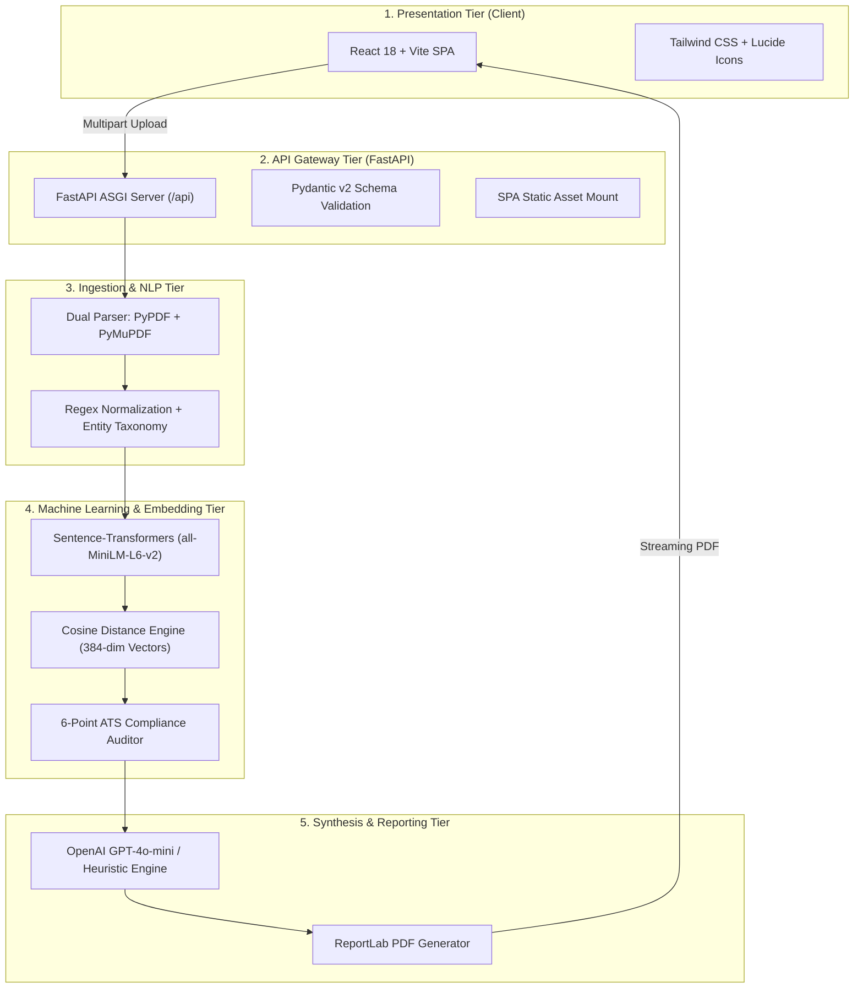

# ResumeAI — AI-Powered Resume Analyzer & Job Matcher

[](https://fastapi.tiangolo.com)
[](https://react.dev)
[](https://huggingface.co/sentence-transformers/all-MiniLM-L6-v2)
[](https://openai.com)
[](https://pypdf.readthedocs.io)
[](https://docker.com)
[](LICENSE)

[](https://render.com/deploy?repo=https://github.com/beingdeveloper21/ResumeAI)

> **ResumeAI** is a production-grade, automated resume intelligence platform that extracts structured competencies from candidate PDF resumes, benchmarks alignment against job descriptions using dense bi-encoder semantic embeddings, conducts a deterministic ATS compliance audit, and generates Google XYZ-formula bullet rewrites and tailored technical interview questions.

---

## 🌟 Key Engineering Capabilities

- **Automated Structured Entity Extraction:** Ingests raw PDF resumes using a dual-engine parser (**PyPDF** stream extraction with automatic **PyMuPDF / fitz** coordinate-sorting fallback) to extract contact details, categorized skills across 6 technical domains, chronological work experience, and education.
- **Dense Semantic Similarity Benchmarking:** Implements **Sentence-Transformers (`all-MiniLM-L6-v2`)** to generate 384-dimensional dense vector representations of resume sections and job descriptions. Computes unit-normalized **Cosine Distance** in sub-15ms on CPU, eliminating the "vocabulary mismatch" flaw of traditional keyword-matching ATS engines.
- **Deterministic ATS Compliance Audit:** Runs a 6-point recruiter audit evaluating contact completeness, document length bounds (350–1200 words), quantified metrics density (%, \$, throughput), action verb impact, and clear educational structuring.
- **LLM-Driven Feedback & Interview Prep Engine:** Delivers targeted, actionable bullet-point transformations following **Google's XYZ formula** (*"Accomplished [X], as measured by [Y], by doing [Z]"*) and synthesizes customized Technical, System Design, and Behavioral interview questions with model answers and key talking points.
- **Publication-Grade PDF Reporting:** Automatically compiles candidate evaluations, match scorecards, and interview talking points into an official multi-page PDF report powered by **ReportLab**.

---

## 🏗️ System Architecture



---

## 💻 Tech Stack & Justifications

| Component | Technology | Engineering Justification |
|---|---|---|
| **Backend Gateway** | **FastAPI (Python 3.11/3.13)** | Asynchronous ASGI non-blocking event loop, sub-millisecond route dispatching, compile-time Pydantic v2 validation, automated OpenAPI docs. |
| **Semantic Embedding** | **Sentence-Transformers (`all-MiniLM-L6-v2`)** | 384-dimensional dense semantic vectors. 120MB lightweight memory footprint, sub-15ms CPU inference, solves vocabulary mismatch. |
| **Mathematical Metric** | **Cosine Distance & Similarity** | Angular orientation measurement invariant to document length differences: $\frac{u \cdot v}{\|u\|_2 \|v\|_2}$. |
| **PDF Extraction** | **PyPDF + PyMuPDF (`fitz`)** | Dual-engine fallback: lightweight pure-Python stream parsing + C-based bounding-box reading order sorting for multi-column resumes. |
| **LLM Synthesis** | **OpenAI API + Smart Heuristic Engine** | Structured JSON schema outputs for XYZ bullet rewrites and interview questions, with zero-downtime offline heuristic fallback. |
| **Frontend UI** | **React 18 + Vite + Tailwind CSS** | Ultra-responsive modern SPA, instant HMR, dark glassmorphism design, Lucide icons, and Canvas Confetti. |
| **Report Generation** | **ReportLab 5.1** | Deterministic vector PDF generation with custom page canvas numbering and clean tabular formatting. |
| **Containerization** | **Multi-stage Docker** | Stage 1 builds minified React bundle; Stage 2 bundles lightweight Python runtime serving API and static UI on single port. |

---

## 🚀 Quickstart & Local Setup

### Prerequisites
- Python 3.10+ (Python 3.11/3.12/3.13 supported)
- Node.js 18+ and npm
- (Optional) OpenAI API Key for live GPT-4o feedback (the app works out-of-the-box with built-in heuristic synthesis even without an API key).

### 1. Clone Repository
```bash
git clone https://github.com/beingdeveloper21/ResumeAI.git
cd ResumeAI
```

### 2. Backend Setup
```bash
# Create virtual environment (optional)
python -m venv .venv
source .venv/bin/activate  # On Windows: .venv\Scripts\activate

# Install dependencies
pip install -r backend/requirements.txt

# (Optional) Set environment variables
cp backend/.env.example backend/.env
```

### 3. Frontend Setup & Build
```bash
cd frontend
npm install
npm run build   # Builds production assets directly into backend/app/static
cd ..
```

### 4. Run Application
```bash
# Start FastAPI server (serves both API and built React UI)
python -m uvicorn app.main:app --app-dir backend --host 0.0.0.0 --port 8000 --reload
```
Open your browser at: **`http://localhost:8000`**

- **Interactive UI:** `http://localhost:8000`
- **Swagger / OpenAPI Documentation:** `http://localhost:8000/docs`
- **API Health Check:** `http://localhost:8000/api/health`

---

## 🐳 Docker Deployment

Run the complete multi-stage containerized stack with a single command:

```bash
docker compose up --build
```
Access the application at `http://localhost:8000`.

---

## ☁️ Live Cloud Deployment

### 1-Click Free Deployment on Render
1. Push this repository to your GitHub account (`beingdeveloper21/ResumeAI`).
2. Log in to [Render.com](https://render.com) and click **New + > Web Service**.
3. Select your repository `ResumeAI`.
4. Render automatically detects `render.yaml` or select **Docker** runtime.
5. Set environment variable `PORT=8000`.
6. Click **Deploy Web Service**. Your live production app is deployed in ~2 minutes!

---

## 🧪 Running Automated Tests

Run backend unit and integration tests:
```bash
pytest backend/tests/test_all.py -v
```

---

## 📄 Master Architecture & Interview Preparation Guide (PDF)

A comprehensive 20-page master guide was programmatically generated and included in this repository:
- **Location:** [`docs/ResumeAI_Complete_Architecture_and_Interview_Mastery.pdf`](docs/ResumeAI_Complete_Architecture_and_Interview_Mastery.pdf)
- **Includes:**
  - Executive ATS problem statement & architecture diagrams
  - Mathematical derivations for Cosine Distance and Composite Scoring
  - Complete technology stack evaluations (FastAPI vs Flask, Sentence-Transformers vs BM25)
  - 12+ in-depth technical and system design interview questions with model answers (STAR method)

---

## 👤 Author & Maintainer

**Prem Jha**
- GitHub: [@beingdeveloper21](https://github.com/beingdeveloper21)
- Email: `jhaprem4220@gmail.com`
- Repository: [https://github.com/beingdeveloper21/ResumeAI](https://github.com/beingdeveloper21/ResumeAI)

---

## 📜 License
This project is open-source and licensed under the [MIT License](LICENSE).
