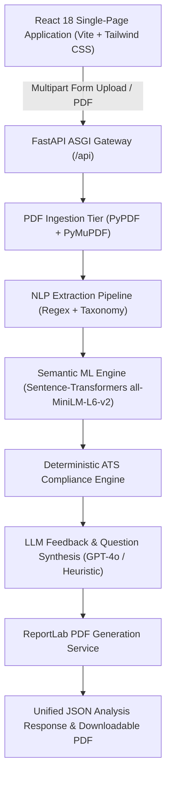

# ResumeAI — System Architecture & Technical Specifications

## 1. Executive Architecture Overview
ResumeAI is an end-to-end automated resume intelligence and job matching platform designed to resolve the semantic limitations of legacy Applicant Tracking Systems (ATS).

---

## 2. Component Breakdown

### 2.1 Presentation Layer (Frontend)
- **Framework:** React 18, Vite, Tailwind CSS, Lucide React Icons.
- **Key Features:**
  - Drag-and-drop resume PDF ingestion with automatic metadata preview.
  - Role presets (Full Stack Engineer, AI/ML Engineer, DevOps Engineer).
  - Dynamic radial score gauge with color-coded tiers.
  - Interactive skill gap matrix categorized into Languages, Frameworks, Cloud, and AI.
  - Expandable Technical and System Design interview prep hub with model talking points.

### 2.2 API Gateway Tier (FastAPI Backend)
- **Framework:** FastAPI running on Starlette ASGI.
- **Validation:** Pydantic v2 data models with strict schema enforcement.
- **CORS:** Configurable CORS origins supporting local development and production cloud domains.
- **Static Asset Serving:** Built-in SPA static fallback serving the React bundle directly.

### 2.3 PDF Ingestion & NLP Tier
- **Dual-Engine Ingestion:** Primary stream parsing using `pypdf`, with automatic failover to `PyMuPDF` (`fitz`) for complex vector layouts, tables, and ligature resolution.
- **Taxonomy Engine:** Normalizes technical terminology across 6 domains (Programming Languages, Frameworks, Cloud/DevOps, AI/ML, Tools, Methodologies).

### 2.4 Semantic Vector Similarity Tier
- **Model:** `sentence-transformers/all-MiniLM-L6-v2`
- **Embedding Dimensionality:** 384 dimensions.
- **Mathematical Similarity:** Unit-normalized Cosine Distance:
  $$\text{Cosine Similarity}(u, v) = \frac{u \cdot v}{\|u\|_2 \|v\|_2}$$
- **Fallback Engine:** Scikit-Learn TF-IDF + Cosine Similarity if offline or during cold start.

### 2.5 LLM Feedback & Interview Engine
- **Engine:** OpenAI API (`gpt-4o-mini`) with strict JSON schema decoding.
- **Resilient Heuristic Fallback:** If API key is omitted or rate-limited, an internal deterministic rule engine synthesizes tailored bullet improvements using Google's XYZ formula.

---

## 3. Composite Weighted ATS Scoring Formula

The overall match score is determined by:
$$\text{Overall Score} = (0.45 \times S_{\text{semantic}}) + (0.35 \times S_{\text{keyword}}) + (0.20 \times S_{\text{ats\_hygiene}})$$

Where:
1. $S_{\text{semantic}} \in [0, 100]$: Dense vector cosine similarity scaled across typical sentence-pair distributions.
2. $S_{\text{keyword}} \in [0, 100]$: Direct proportion of required skills satisfied.
3. $S_{\text{ats\_hygiene}} \in [0, 100]$: Deterministic 6-point check (Contact completeness, Word count bounds, Metric density, Action verbs, Education clarity).
